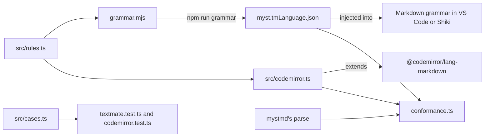

# Contributing to myst-syntax

The [repository README](../../README.md#develop) says how to set up and run the test, conformance, typecheck and build scripts.
This package adds:

- `npm run grammar`: regenerate `myst.tmLanguage.json` from `grammar.mjs`, which is the file to edit.
- `npm run build`: compile to `dist/`, which the other packages import.
  `npm install` runs it through the `prepare` script.

## How it works



`src/rules.ts` holds the regex fragments both parts share.
`grammar.mjs` bakes them into the JSON, and `src/codemirror.ts` imports them at run time.

The TextMate part is an injection grammar, so it has no Markdown rules of its own.
The editor tokenizes the file with its Markdown grammar, and `injectTo` tells it to try MyST's rules too.
The `injectionSelector` limits where: `L:` puts MyST's rules ahead of Markdown's, and the `-` scopes keep them out of code and math.
[What we learned](../../docs/findings.md#why-textmate-and-codemirror-need-different-approaches) explains why every line-anchored rule starts with `(?:^|\G)`.

The CodeMirror part works on top of `@lezer/markdown`, the parser in `@codemirror/lang-markdown`.
`myst()` matches each regex in `patterns` line by line and marks the matches, skipping anything Markdown's syntax tree calls code.
`mystCode` is a Markdown extension that tells the parser which language a `{code-cell}` fence holds, and adds a block parser that reads colon fences as code.

`src/tokenize.ts` runs both parts outside an editor, the way VS Code and CodeMirror would.
The tests and `conformance.ts` both use it.

## To add a syntax

1. Add examples to `cases` in `src/cases.ts`, under a new key, with the names each one should highlight.
2. Add a rule to `grammar.mjs` and its scope to `scopes` in `src/tokenize.ts`, then run `npm run grammar` and commit `myst.tmLanguage.json`.
3. Add a pattern with the same key to `patterns` in `src/codemirror.ts`, and its colours to the theme there.
4. Add a row to the syntax table in the README.
5. Run `npm test` and `npm run conformance`.

## Conformance

`npm run conformance` checks that both parts find the same role names, directive names and target labels as mystmd's parser, on the [myst-spec](https://github.com/jupyter-book/myst-spec) examples.
It prints each miss and a table of matched, missed and excluded examples, and fails if any example is missed.
[What we learned](../../docs/findings.md#conformance-results) says which differences count as excluded.
mystmd leaves the body of a directive it doesn't know, like `{tab-set}`, as text, so the check parses those bodies again to find the names nested inside.

To also check your own MyST projects, point `MYST_CORPUS` at a folder of them:

```sh
MYST_CORPUS=path/to/projects npm run conformance
```

It reads every `.md` file and the Markdown cells of every `.ipynb` file, skipping `node_modules` and `_build`.
Corpus misses are printed but don't fail the command.

## Kept in sync by hand

Nothing checks these, so change them together:

- The math, citation, option body, substitution and footnote patterns in `grammar.mjs` and `patterns` in `src/codemirror.ts`.
- The syntax table in the README and what the two parts highlight.
- `src/rules.ts` and mystmd's rules in `markdown-it-myst`: `TARGET_PATTERN` in `dist/block.js`, and `dist/citations.js`.
