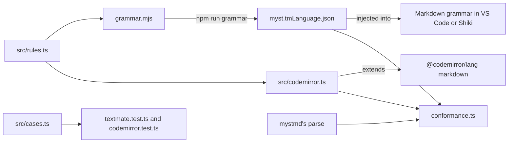

# myst-syntax

Syntax highlighting for [MyST Markdown](https://mystmd.org), on top of an editor's Markdown highlighting.

It has two parts:

- `myst.tmLanguage.json`: a [TextMate grammar](https://macromates.com/manual/en/language_grammars) for editors like VS Code.
  It injects MyST into the editor's Markdown grammar.
- `myst-syntax/codemirror`: a [CodeMirror 6](https://codemirror.net) extension to use with `markdown()`.
  [`jupyterlab-myst-syntax`](https://github.com/choldgraf/myst-syntax/blob/main/packages/jupyterlab/README.md) adds it to JupyterLab.

Both parts take the role and directive name pattern, the label pattern, the citation key characters and the list of code directives from `myst-syntax/rules`, which other tools can import too.
The rest is kept [in sync by hand](#what-must-stay-in-sync-by-hand).

They highlight different syntax:

| Syntax | TextMate | CodeMirror |
| --- | --- | --- |
| Roles, directives, options and labels | ✓ | ✓ |
| Comments (`%`) and block breaks (`+++`) | ✓ | ✓ |
| Substitutions (`{{ x }}`) and footnote references (`[^1]`) | ✓ | ✓ |
| YAML options in a directive | ✓ | No, see [what we learned](https://github.com/choldgraf/myst-syntax/blob/main/docs/findings.md#why-textmate-and-codemirror-need-different-approaches) |
| Inline math (`$x$`) | ✓ | ✓ |
| Display math (`$$`) | ✓ | No, see [what we learned](https://github.com/choldgraf/myst-syntax/blob/main/docs/findings.md#why-textmate-and-codemirror-need-different-approaches) |
| Citations (`@key`, `[@a; @b]`) | ✓ | ✓ |
| Code in code directives, like `{code-cell} python` | ✓ | ✓ |

Both parts highlight directives in backtick, tilde and colon fences.
Directives, labels, comments and block breaks are highlighted at the top level, inside list items and inside blockquotes.
TextMate highlights code directives in common languages, such as Python, R and JavaScript.
In TextMate, code directives in other languages, or without one, stay plain, and so do `{math}`, `{mermaid}` and `{raw}`.

The TextMate grammar takes inspiration from chrisjsewell's [`vscode-myst-syntax`](https://github.com/chrisjsewell/vscode-myst-syntax).
See the [roadmap](https://github.com/choldgraf/myst-syntax/blob/main/ROADMAP.md) for what's next, and [what we learned](https://github.com/choldgraf/myst-syntax/blob/main/docs/findings.md) for why it works the way it does.

## Install it

Install it from npm:

```sh
npm install myst-syntax
```

## Use it

In a VS Code extension, copy `node_modules/myst-syntax/myst.tmLanguage.json` into the extension when you build it.
Then add the copy to the extension's `package.json`:

```json
"contributes": {
  "grammars": [
    { "scopeName": "text.myst.injection", "path": "./myst.tmLanguage.json", "injectTo": ["text.html.markdown"] }
  ]
}
```

The repo's own [VS Code extension](https://github.com/choldgraf/myst-syntax/blob/main/packages/vscode/README.md) does exactly this.

In CodeMirror:

```ts
import { markdown } from '@codemirror/lang-markdown';
import { languages } from '@codemirror/language-data';
import { EditorView } from '@codemirror/view';
import { myst, mystCode } from 'myst-syntax/codemirror';

new EditorView({ extensions: [markdown({ codeLanguages: languages, extensions: [mystCode(languages)] }), myst()] });
```

`myst()` adds a `cm-myst-<name>` class to each match, such as `cm-myst-role`, with colours for light and dark themes.
It skips code, so `@property` in a Python block isn't a citation.
`mystCode` highlights code directives in their language, as `codeLanguages` does for plain ```` ```python ```` blocks.
It also parses colon-fenced code directives, like `:::{code-cell} python`, as code, which Markdown doesn't.
Leave out `codeLanguages` and `mystCode` if you don't want code highlighted.

The CodeMirror extension ships as JavaScript with type declarations.

### Using with Shiki

[Shiki](https://shiki.style) can load the grammar and inject it into Markdown:

```ts
import { createHighlighter } from 'shiki';
import myst from 'myst-syntax/myst.tmLanguage.json' with { type: 'json' };

const highlighter = await createHighlighter({ themes: ['github-light'], langs: ['yaml', 'markdown', myst] });
highlighter.codeToHtml(src, { lang: 'markdown', theme: 'github-light' });
```

Load `yaml` first, then `markdown`, then the grammar, and nothing else.
The order works around a Shiki bug, described in [what we learned](https://github.com/choldgraf/myst-syntax/blob/main/docs/findings.md#shiki-drops-markdowns-injections).
To load more languages, pass Markdown with its lazy list emptied, and then the order doesn't matter:

```ts
import markdown from '@shikijs/langs/markdown';

langs: ['yaml', 'python', { ...markdown[0], embeddedLangsLazy: [] }, myst]
```

## How it works



`src/rules.ts` holds the regex fragments both halves share.
`grammar.mjs` imports them when it writes the JSON, so they are baked into the grammar, and `src/codemirror.ts` imports them at run time.

The TextMate half is an injection grammar, so it has no Markdown rules of its own.
The editor tokenizes the file with its Markdown grammar, and `injectTo` tells it to try MyST's rules too.
The `injectionSelector` limits where: `L:` puts MyST's rules ahead of Markdown's, and the `-` scopes keep them out of code and math.
MyST's rules see a line only after Markdown's list and block quote rules have taken its markers, which is why every line-anchored rule starts with `(?:^|\G)`.
[What we learned](https://github.com/choldgraf/myst-syntax/blob/main/docs/findings.md#why-textmate-and-codemirror-need-different-approaches) has the detail.

The CodeMirror half works on top of `@lezer/markdown`, the parser in `@codemirror/lang-markdown`.
`myst()` matches each regex in `patterns` line by line and marks the matches, skipping anything Markdown's syntax tree calls code.
`mystCode` is a Markdown extension: it tells the parser which language a `{code-cell}` fence holds, and adds a block parser that reads colon fences as code.

`src/tokenize.ts` runs both halves outside an editor.
It loads the JSON into `vscode-textmate` the way VS Code does, and matches the CodeMirror patterns against a real syntax tree.
The two test files use it to check every example in `src/cases.ts`, and `conformance.ts` uses it to compare both halves with mystmd.

### To add a syntax

1. Add examples to `cases` in `src/cases.ts`, under a new key, with the names each one should highlight.
2. Add a rule to `grammar.mjs` and its scope to `scopes` in `src/tokenize.ts`, then run `npm run grammar` and commit `myst.tmLanguage.json`.
3. Add a pattern with the same key to `patterns` in `src/codemirror.ts`, and its colours to the theme there.
4. Add a row to the syntax table at the top of this README.
5. Run `npm test`.
6. Run `npm run conformance`.

Then check [what must stay in sync by hand](#what-must-stay-in-sync-by-hand).

## Develop

The [repository README](https://github.com/choldgraf/myst-syntax/blob/main/README.md#develop) says how to set up and run the test, conformance, typecheck and build scripts.
This package adds:

- `npm run grammar`: regenerate `myst.tmLanguage.json` from `grammar.mjs`, which is the file to edit.
- `npm test`: the grammar runs under `vscode-textmate`, the library VS Code uses.
- `npm run build`: compile to `dist/`, which the other packages import.
  `npm install` runs it through the `prepare` script.

### Conformance

`npm run conformance` checks that both parts find the same role names, directive names and target labels as mystmd's parser.
It runs on the [myst-spec](https://github.com/jupyter-book/myst-spec) examples.
It prints each miss and a table of matched, missed and excluded examples, and fails if any example is missed.
[What we learned](https://github.com/choldgraf/myst-syntax/blob/main/docs/findings.md#conformance-results) says which differences count as excluded.
mystmd leaves the body of a directive it doesn't know, like `{tab-set}`, as text, so the check parses those bodies again to find the names nested inside.

To also check a folder of your own MyST projects, point `MYST_CORPUS` at it:

```sh
MYST_CORPUS=path/to/projects npm run conformance
```

This reads every `.md` file and the Markdown cells of every `.ipynb` file, skipping `node_modules` and `_build`.
Corpus misses are printed, but don't make the command fail.

### What must stay in sync by hand

- The `math|mermaid|raw` lookahead in `grammar.mjs` and the `excluded` pattern in `conformance.ts`.
- The math and citation patterns in `grammar.mjs` and `patterns` in `src/codemirror.ts`.
- The scope names in `grammar.mjs` and the `scopes` map in `src/tokenize.ts`.
- The keys of `cases` in `src/cases.ts` and of `patterns` in `src/codemirror.ts`.
- The syntax table at the top of this README and what the two parts highlight.
- `src/rules.ts` and mystmd's rules in `markdown-it-myst`: `TARGET_PATTERN` in `dist/block.js`, and `dist/citations.js`.
- The second Shiki recipe and the shape of `markdown[0]` in `@shikijs/langs/markdown`.
